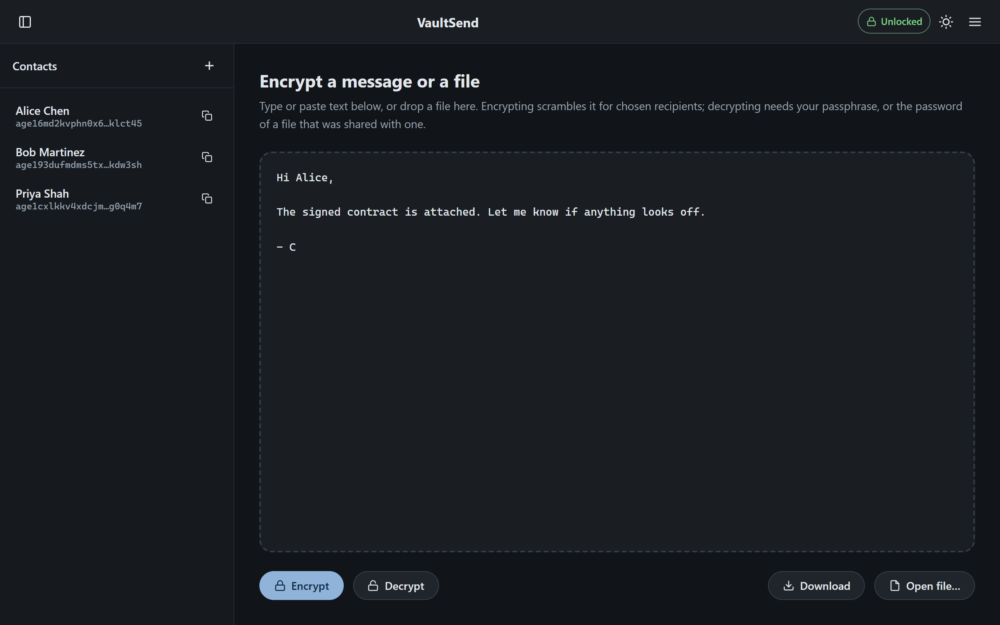

<h1>
  
  VaultSend (web)
</h1>

**Encrypt messages and files in your browser with the [age](https://age-encryption.org) format: one HTML file, fully offline, no accounts, no servers.**

### ▶ Try it: **[caelen.ca/vaultsend](https://caelen.ca/vaultsend)**

[](LICENSE)




VaultSend's web build is the whole app in a single `index.html`. Open it from
[caelen.ca/vaultsend](https://caelen.ca/vaultsend), install it as an app, or save the file
and open it from disk with no connection at all. Everything it encrypts is a standard age
file, readable by the `age` and `rage` command-line tools and by the
[VaultSend desktop app](https://github.com/caelenm/vaultsend/tree/main).

## Contents

- [Features](#features)
- [How it relates to the desktop app](#how-it-relates-to-the-desktop-app)
- [Why a single HTML file?](#why-a-single-html-file)
- [Security](#security)
- [Verify the build yourself](#verify-the-build-yourself)
- [Run it locally](#run-it-locally)
- [Using VaultSend](#using-vaultsend)
- [Development](#development)
- [Repository layout](#repository-layout)
- [Credits and license](#credits-and-license)

## Features

| | |
|---|---|
| **Your own key** | Generate an age identity in the browser. The private key is encrypted with your passphrase (scrypt) before it is stored, and never leaves the device. |
| **Encrypt text or files** | To one or more contacts, as armored text to paste anywhere or as a downloadable `.age` file. You are always included so you can read it back. |
| **Decrypt** | age files and armored messages made for your key, or made with a password. |
| **Drag and drop** | Drop a file to encrypt or decrypt it; drop a folder and it is zipped first. |
| **Contacts** | Save people's public keys by name; import and export them as JSON. |
| **Portable identity** | Export and import a passphrase-protected `identity.age`, the same file the desktop app uses. |
| **Open vault shares** | Open what someone shared from a desktop or Android vault: browse an archive's files and save one, all of them into a new folder, or the `.tar` as is. |
| **No key needed for passwords** | Open a password-protected file straight from the welcome page without creating a key. |
| **Session lock** | The unlocked key auto-locks when idle or when the tab is hidden, and can be locked at once from the menu. |
| **Built-in verification** | **Verify integrity** and **Run crypto self-test** in the menu check the running code against its pinned hashes and known upstream test vectors. |
| **Installable** | A hosted copy installs as an app (PWA) and keeps working offline. |
| **Accessible** | Light and dark themes, keyboard-navigable menus, screen-reader labels. |

## How it relates to the desktop app

VaultSend has three clients that share one file format:

| | Web (this branch) | [Desktop](https://github.com/caelenm/vaultsend/tree/main) | [Android](https://github.com/caelenm/vaultsend/tree/android) |
|---|:-:|:-:|:-:|
| Encrypt / decrypt text and files | ✅ | ✅ | ✅ |
| Contacts | ✅ | ✅ | ✅ |
| Same `identity.age` key file | ✅ | ✅ | ✅ |
| Open files shared from a vault | ✅ | ✅ | ✅ |
| Create and manage **vaults** | ❌ | ✅ | ✅ |
| Install needed | none | Linux AppImage | APK |
| Where the private key is handled | browser JavaScript | isolated, hardened Rust process | Rust core |

Use the web build when you need VaultSend on a machine where you can't or don't want to
install anything, or to send something quickly. Use the desktop or Android app for
**vaults** (encrypted folders), and for the stronger key isolation a native process
can give. A file encrypted in any one of them decrypts in the others.

## Why a single HTML file?

An encryption tool is only as trustworthy as the code that actually runs. Shipping one file
with everything inlined means:

- nothing to install and nothing fetched at runtime;
- the exact bytes that execute are fixed, hashed and pinned, so they can be audited;
- you can save it, archive it, re-verify it and run it offline indefinitely.

## Security

> [!WARNING]
> VaultSend has **not had a third-party security audit**. The cryptography comes from
> widely used, well-reviewed libraries, but review the code and verify the build before
> relying on it for anything important.

### What it does well

- **No network access, by construction.** A strict Content-Security-Policy sets
  `default-src 'none'`, so the page cannot make any request: no `fetch`, XHR, WebSocket or
  beacon. Your keys and plaintext have nowhere to go.
- **Only pinned code runs.** Both inline scripts are allowed by SHA-256 hash, with no
  `'self'`, `unsafe-inline` or `unsafe-eval`. If a single byte changes, the browser refuses
  to run it, so a host, cache or CDN can't swap code in.
- **Reproducible, standard cryptography.** The only third-party code is a tree-shaken bundle
  of the [typage](https://github.com/FiloSottile/typage) age implementation and the
  [noble](https://paulmillr.com/noble/) libraries (X25519, ChaCha20-Poly1305, HKDF, scrypt),
  rebuilt byte for byte from pinned releases by `verify.sh`.
- **Encrypted at rest.** The private key is stored only as a passphrase-encrypted age blob.
  The passphrase itself is never stored.
- **Short-lived unlocked key.** Once unlocked, the key is kept as a byte buffer that is wiped
  on lock, auto-locks after 5 minutes idle and shortly after the tab is hidden, and is wiped
  when the page unloads. A "don't remember" option asks every time.
- **Shared archives treated as hostile.** Archives are fully decrypted and authenticated
  before they are read, and unsafe names, links, special files and oversized content are
  refused, using the same rules as the desktop and Android apps. Nothing is saved until you
  choose to save it.
- **Bounded work.** Password files asking for an unusually expensive scrypt setting are
  refused before any work is done.

### Limitations

- **A browser is a weaker place for a key than a native app.** Malware, or a malicious
  browser extension, running in your browser can read anything the page can. The desktop
  app keeps the key in a separate, hardened process.
- **JavaScript can't guarantee memory is wiped.** VaultSend keeps plaintext short-lived, but
  the browser may still hold copies of strings it can't clear.
- **Your key lives in this browser's storage.** Clearing site data deletes it. Export
  `identity.age` as a backup, and choose a strong passphrase, because the stored key is only
  as strong as that passphrase.
- **No vaults.** The web build opens files shared *from* a vault but can't create, open or
  import vaults themselves.
- **It can't protect a compromised device or OS**, and it can't stop you encrypting to the
  wrong key: confirm a contact's full `age1…` key with them through another channel.
- **Hosting needs one extra header.** Browsers ignore `frame-ancestors` in a `<meta>` CSP, so
  a hosted copy should send `Content-Security-Policy: frame-ancestors 'none'` itself.

See [SECURITY.md](SECURITY.md) for the session-lock model and operational notes. To report a
vulnerability, please contact the author privately through [caelen.ca](https://caelen.ca)
rather than opening a public issue.

## Verify the build yourself

You don't have to take the bundled code on faith. There are three ways to check it:

1. **In the app.** **Menu → Verify integrity** hashes the two running scripts and compares
   them with the CSP pins and the documented build hash. **Menu → Run crypto self-test**
   decrypts ciphertexts produced by the genuine upstream library, reproduces a known
   key mapping, and runs a live round trip and a tamper check.
2. **One command** (needs Node.js, npm and Python 3):

   ```sh
   bash verify.sh index.html
   # ✅  PASS — Embedded bundle is byte-identical to the pinned upstream rebuild.
   ```

   It extracts the embedded bundle, rebuilds it from the pinned sources and compares
   hashes. It checks its prerequisites first and has an offline hash-only fallback.
3. **By hand**, following [PROVENANCE.md](PROVENANCE.md), which also lists what a
   reproducible build does and doesn't prove.

<details>
<summary><b>Manual rebuild steps</b></summary>

```sh
npm i age-encryption@0.2.4 fflate@0.8.2 esbuild@0.28.1 \
      @noble/ciphers@1.3.0 @noble/curves@1.9.7 \
      @noble/hashes@1.8.0 @scure/base@1.2.6

cat > entry.js <<'JS'
import {generateIdentity,identityToRecipient,Encrypter,Decrypter,armor} from "age-encryption";
import {zipSync} from "fflate";
globalThis.__VS_AGE__={generateIdentity,identityToRecipient,Encrypter,Decrypter,armor};
globalThis.__VS_FFLATE__={zipSync};
JS

npx esbuild entry.js --bundle --format=iife --platform=browser \
  --target=es2020 --minify --legal-comments=none --outfile=vendor.min.js

sha256sum vendor.min.js
# 2029930d2807bd3b37d5d4718194b77dd086ba7d420a18176cbdc616960c9eb2
```

That digest equals the CSP pin `sha256-ICmTDSgHvTs31dRxgZS3fdCGun1CChgXbL3GFpYMnrI=`.

| Package | Version | License |
|---|---|---|
| age-encryption | 0.2.4 | MIT |
| @noble/ciphers | 1.3.0 | MIT |
| @noble/curves | 1.9.7 | MIT |
| @noble/hashes | 1.8.0 | MIT |
| @scure/base | 1.2.6 | MIT |
| fflate | 0.8.2 | MIT |
| esbuild (build only) | 0.28.1 | MIT |

</details>

## Run it locally

There is nothing to build. Either:

- **Open the file:** download `index.html` and open it in any modern browser. It works from
  `file://` with no connection.
- **Serve the folder** (needed to install it as an app):

  ```sh
  python3 -m http.server 8000
  # then open http://localhost:8000
  ```

<details>
<summary><b>Hosting and installing as an app</b></summary>

Browsers only offer to install a page served over `https`. To make a hosted copy installable
(Chrome, Edge and Android: the install button in the address bar; Safari: Share → Add to Home
Screen / Add to Dock), host these beside `index.html`:

| File | Purpose |
|---|---|
| `manifest.webmanifest` | Name, colours and icons of the installed app. |
| `icons/` | The app icon, 192 and 512 px. |
| `sw.js` | Service worker that keeps a copy of these files so the app opens offline. |

What changes in the security model:

- The CSP gains `manifest-src 'self'` and `worker-src 'self'`; `script-src` is unchanged.
- `sw.js` is the one script not pinned by hash, because a service worker can't be inline. It
  runs in its own context, never sees keys, text or files, and only re-fetches VaultSend's own
  files from its own origin.
- The page itself still makes no network requests.

Don't want a service worker? Don't host `sw.js`. Everything else works; the installed app just
won't open offline.

</details>

## Using VaultSend

1. **Create your key** and choose a strong passphrase, then copy your public key (`age1…`)
   to share with people.
2. **Add contacts** by pasting the public keys others share with you.
3. **Encrypt:** type a message or drop a file, tick the recipients, then copy or download the
   result. Only ticked recipients (and you) can decrypt it.
4. **Decrypt:** paste an armored message or drop an `.age` file, and unlock with your
   passphrase, or with the password it was made with.
5. **Open a vault share:** drop the file someone shared from their vault and click
   **Decrypt**. A `Name.tar.age` archive lists its contents so you can choose what to save.
   With only a password, choose **Open it without a key** on the welcome page.
6. **Back up:** **Menu → Export identity.age** saves `identity.age`, which also works in the
   desktop and Android apps.

> **"This was not encrypted to you"?** Your key wasn't among the file's recipients. Ask the
> sender to re-encrypt with you ticked, and check that the `age1…` key they saved for you
> matches your current one. See [SECURITY.md](SECURITY.md).

## Development

| Task | Command |
|---|---|
| Re-pin the CSP script hashes after editing an inline script | `python3 update-csp.py` |
| Check that the pins are current | `python3 update-csp.py --check` |
| Test the shared-archive reader inside `index.html` | `node tests/shared_archive_test.mjs` |
| Verify the embedded crypto bundle | `bash verify.sh index.html` |

## Repository layout

| File | Purpose |
|---|---|
| `index.html` | The whole application. Open this. |
| `verify.sh` | Reproducible-build verifier. |
| `update-csp.py` | Re-pins the CSP script hashes after an edit. |
| `manifest.webmanifest`, `icons/`, `sw.js` | Optional: make a hosted copy installable. |
| `tests/shared_archive_test.mjs` | Tests for the shared-archive reader (Node). |
| `PROVENANCE.md` | Pinned versions and what reproducibility proves. |
| `SECURITY.md` | Session-lock model and operational notes. |
| `docs/screenshot.png` | The screenshot above. |
| `LICENSE` | GPL-3.0. |

## Credits and license

VaultSend builds on the work of:

- **age / typage**: Filippo Valsorda
- **noble** (ciphers, curves, hashes) and **scure/base**: Paul Miller
- **fflate**: Arjun Barrett
- **esbuild**: Evan Wallace

All bundled dependencies are MIT-licensed. VaultSend is released under the
[GNU GPL v3](LICENSE) and is provided as-is, without warranty.

VaultSend's design, functionality and code review are by [me](https://caelen.ca), with the
technical implementation done with the help of [Claude](https://claude.ai).

My public key: `age192d2u5rkgv9nvl9858fhyqsk78shhgknfjydukfgepu5c608439qnk8z62`
