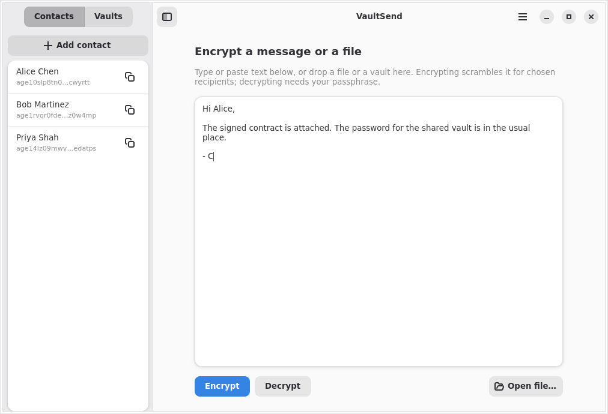
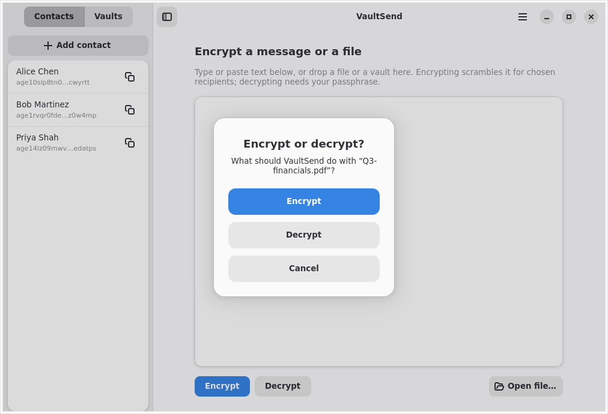
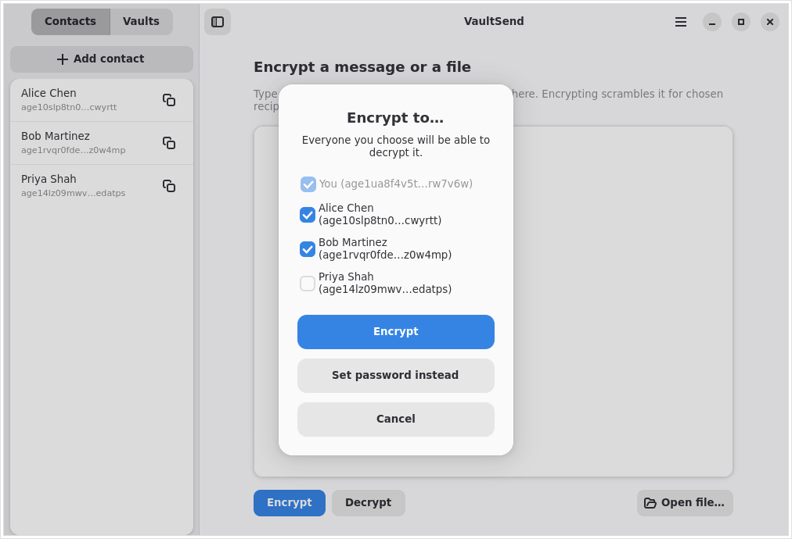
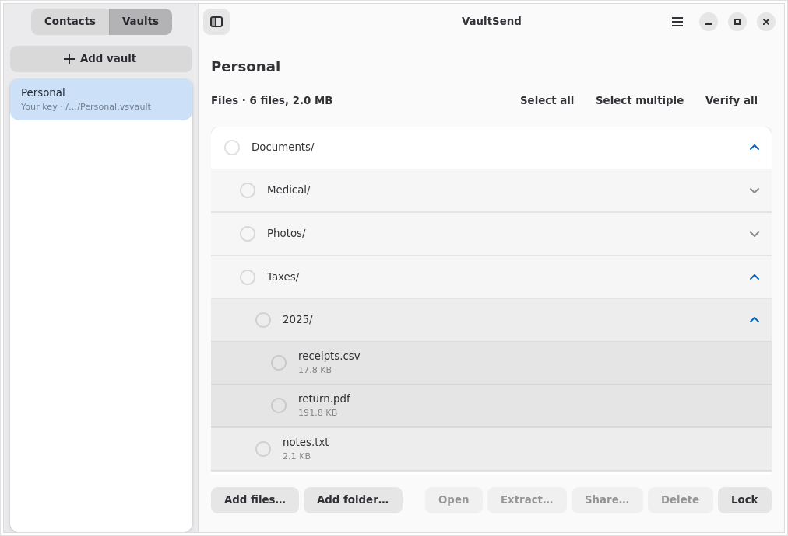
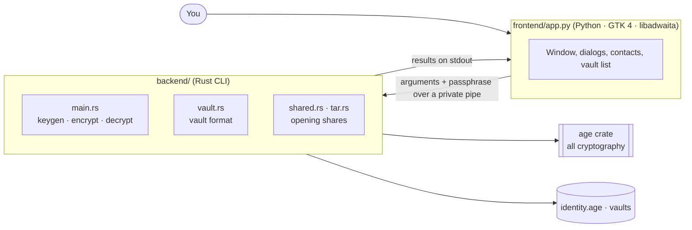

<h1>
  
  VaultSend
</h1>

**A small, auditable Linux desktop app for encrypting messages, files and whole folders to the people you choose.**

[](LICENSE)


| Main view | Drag and drop a file |
|---|---|
|  |  |
| **Select contacts** | **Vaults** |
|  |  |

VaultSend wraps the [age](https://age-encryption.org) encryption format in a friendly GTK app.
Encrypt a message or a file to any number of contacts, keep whole folders encrypted at rest in
**vaults**, and share from a vault without ever writing plaintext to disk. The design goal is
that one person can read the entire codebase in an afternoon and trust it does
what it says.

## Contents

- [Features](#features)
- [Architecture](#architecture)
- [Security](#security)
- [Install](#install)
- [Build from source](#build-from-source)
- [Run](#run)
- [Using VaultSend](#using-vaultsend)
- [Testing](#testing)
- [Project layout](#project-layout)
- [Reference](#reference)
- [Acknowledgements](#acknowledgements)

## Features

| | |
|---|---|
| **Text** | Type or paste a message and encrypt it to one or more recipients. The result is armored (ASCII) text you can paste into any email or chat. Decrypting reverses it, and the plaintext stays on screen, never on disk. |
| **Files** | Drag a file onto the window or use **Open file…**. Files stream through the backend instead of loading into memory, and output is only renamed into place once it is complete and authenticated. |
| **Multiple recipients** | Tick any number of contacts; you are always included so you can re-read what you sent. age encrypts the body once and wraps its key per recipient, so adding people costs nothing in security. |
| **Contacts** | A plain JSON address book of names and public keys. Nothing in it is secret, so it is safe to back up, sync or version-control. |
| **Vaults** | Encrypted folders you can change one file at a time: add files and folders, extract, delete, share, verify the whole vault for tampering, or open a file in its default app from a copy held in RAM. Protect a vault with your own key or with a password to share it. File names and folder structure stay hidden. |
| **Sharing** | Share files or folders from a vault with a contact or a password. The recipient opens them on the main page and can unpack them, save them, or add them straight into one of their own vaults. |
| **Remember passphrase** | Optional, off by default. Keeps your passphrase in memory for a period you choose, with **Lock now** in the menu. |
| **Interoperable** | Everything VaultSend writes outside a vault is a standard age file, readable with the `age` / `rage` command-line tools. |
| **No network** | No network code, no telemetry, no key servers, no plugins. |

## Architecture



VaultSend is split into two processes with a hard boundary between them:

- **`backend/`, a Rust command-line tool.** It is the **only** component that ever handles your
  private key. All cryptography is delegated to the [`age`](https://github.com/str4d/rage)
  crate; the backend contains no hand-written crypto, only file handling, the vault format and
  process hardening. It is usable and testable on its own (see the CLI under [Reference](#reference)).
- **`frontend/`, a single-file GTK 4 / libadwaita app in Python.** It draws the window and keeps
  your contacts. It never sees your private key: when a passphrase is needed it is handed to
  the backend over a private file descriptor (never a command-line argument) and then dropped.

Some of the design decisions behind it:

| Decision | Why |
|---|---|
| Separate backend process | Keeps every secret in one small, memory-safe, hardened process that is easy to audit in isolation. |
| No custom cryptography | age is modern, well reviewed and simple. VaultSend only composes it. |
| Secrets over a file descriptor | Command-line arguments are visible to other processes; a pipe is not. |
| Stage, verify, then rename | A truncated or tampered input never leaves partial plaintext or a half-written file behind. |
| One blob per vault file | Changing one file re-encrypts one file, which makes vaults practical in synced folders. |
| Few dependencies, pinned and verified | `tests/verify_deps.sh` checks every crate against `Cargo.lock` and crates.io checksums. |

## Security

> [!WARNING]
> VaultSend is a personal project and **has not been audited by a third party**. The
> cryptography is the well-reviewed `age` library, but the code around it has only had the
> author's own review and testing. Don't rely on it where a flaw would be catastrophic.

### What it does well

- **Standard, reviewed cryptography.** X25519 and ChaCha20-Poly1305 via age; scrypt for
  passphrases at the standard work factor. New passphrases must be at least 10 characters.
- **Private key isolation.** The private key is generated by the backend, stored encrypted
  with your passphrase (`identity.age`, created atomically with `0600` permissions), and only
  ever decrypted inside the backend process. Your public key is cached in the clear so you can
  encrypt without unlocking anything.
- **Process hardening (Linux).** The backend disables core dumps, marks itself non-dumpable so
  other processes running as you can't read its memory, keeps the passphrase and decrypted key
  in buffers that are wiped on drop, and locks those buffers out of swap.
- **Authenticated before written.** Decrypted output is staged and only moved into place after
  the whole input has authenticated. Vault contents are fully decrypted and verified in memory
  before a single byte is written.
- **Tamper-evident vaults.** Each vault has an encrypted manifest that pins every file by
  SHA-256, so altered, truncated, swapped, deleted or stale files are detected before they are
  decrypted. Each device also remembers a vault's generation and warns if it goes backwards.
- **Vaults can't be forged.** A vault's key is sealed with a secret only your private key can
  produce, so someone who knows your public key still can't make a vault that opens for you.
- **Hostile input handling.** Archives and vaults from elsewhere are treated as untrusted:
  unsafe paths, links and special files are refused, sizes are bounded, and everything is
  verified in a private staging area before any of it reaches your folders.
- **Small attack surface.** No network code, no plugins, a handful of dependencies, and a
  codebase small enough to read end to end.

### Limitations

- **Not audited**, as above.
- **It can't protect you from a compromised machine.** Malware running as root, a keylogger or
  a compromised display server can see what you type and what you decrypt.
- **Swap isn't fully covered.** The backend's own secret buffers are locked in memory, but some
  memory (inside libraries, and the frontend's remembered passphrase if you turn that on) can
  still reach swap or a hibernation image. Use encrypted swap, or none.
- **Remember passphrase is a trade-off.** It is never written to disk, but Python can't
  reliably wipe it from memory. It is off by default.
- **Opening a vault file hands it to another app.** VaultSend keeps its copy in RAM and deletes
  it when you lock, but the app you open it with may keep its own copies (thumbnails, autosave,
  recent files). VaultSend warns you the first time.
- **Vaults hide contents and names, not everything.** Anyone who can see the vault folder can
  see how many files it holds, their approximate sizes, and when they changed.
- **Rollback detection is per device.** Only a device that has already seen a newer version of
  a vault can warn that it has gone backwards.
- **Linux only.** Process hardening is Linux-specific, and there is no Windows or macOS build,
  by design, to keep scope and attack surface small.

### Reporting a vulnerability

Please don't open a public issue with exploit details. Contact the author privately through
[caelen.ca](https://caelen.ca). The [auditing guide](#where-to-look-when-auditing) below points to
the code that matters most, so reports can be specific.

## Install

One command on Linux downloads the build dependencies, compiles VaultSend, packs it into an
AppImage and adds it to your launcher:

```sh
curl https://raw.githubusercontent.com/caelenm/vaultsend/refs/heads/main/install.sh | bash
```

## Build from source

**Requirements:** Rust 1.75+ (`cargo`), Python 3, GTK ≥ 4.10 and libadwaita ≥ 1.5 with their
Python bindings. Install the GTK bindings from your distribution, not pip; PyGObject from pip
won't find the system GTK.

```sh
# Debian / Ubuntu
sudo apt install python3-gi gir1.2-gtk-4.0 gir1.2-adw-1 cargo

# Fedora
sudo dnf install python3-gobject gtk4 libadwaita cargo

# Arch
sudo pacman -S python-gobject gtk4 libadwaita cargo
```

Then, from the repository root:

| Command | What it does |
|---|---|
| `make build` | Builds the release backend into `backend/target/release/`. |
| `make run` | Builds if needed and starts the app. |
| `make appimage` | Packs backend and frontend into `appimage/VaultSend-x86_64.AppImage`. |
| `make clean` | Removes build output. |

The AppImage bundles the backend and frontend but deliberately **not** GTK, libadwaita or
PyGObject, so the system packages above are still required. If you can run a GTK 4 app such as
GNOME Text Editor, the AppImage will work.

## Run

```sh
make run
# or
./appimage/VaultSend-x86_64.AppImage
# on systems without FUSE (minimal distros, containers)
./appimage/VaultSend-x86_64.AppImage --appimage-extract-and-run
```

On first launch VaultSend asks you to choose a passphrase, which creates your key. The
frontend finds the backend through `$VAULTSEND_BACKEND`, then `backend/target/release/`, then
your `PATH`.

**No window?** Launch it from a terminal to see errors. The most common cause is a GTK or
libadwaita older than 4.10 / 1.5, which the app reports in one line.

## Using VaultSend

**Encrypt and decrypt**

- **Text:** type or paste a message, click **Encrypt**, tick recipients, and copy the armored
  text that replaces it. To decrypt, paste armored text, click **Decrypt** and enter your passphrase.
- **Files:** drop a file on the window (or **Open file…**), choose **Encrypt** or **Decrypt**, then
  where to save the result.
- **Contacts:** **Add contact** and paste their `age1…` public key. Click a contact to copy their key.
  Your own public key is in the menu (☰); share it so others can encrypt to you.

**Vaults**

- Switch the sidebar to **Vaults**, click **Add vault**, and choose your key or a password.
- Select a vault and **Unlock** it. **Add files…**, **Add folder…** or drag-and-drop add content
  (into the selected folder, if one is selected).
- **Open**, **Extract…**, **Share…** and **Delete** act on the selection. **Select multiple**
  and **Select all** act on several items at once.
- **Verify all** decrypts and checks every file, and tidies up leftovers from an interrupted change.
  If the vault lives in a synced folder, change it from one device at a time and let syncing
  finish before running Verify all.
- **Add existing vault…** re-attaches a restored vault or one someone shared with you. You can
  also drop a vault folder on the main page and click **Decrypt**.
- **Open** shows a file in its default app from a copy in RAM, deleted when you lock the vault
  or close VaultSend. Changes aren't saved back: use **Save As** in that app and add the file
  back with **Replace**.

## Testing

The backend has unit tests alongside the code, and `tests/` holds end-to-end, adversarial and
GUI suites that run against the real release binary in a throwaway home directory, so your own
keys are never touched.

| Suite | Command | Covers |
|---|---|---|
| Backend unit tests | `cd backend && cargo test` | Vault format, manifest parsing, path validation, archive reading, share handling. |
| Frontend helpers | `python3 tests/test_frontend_helpers.py` | The window-free logic in `app.py`. |
| Vault round trip | `tests/vault_roundtrip.sh` | Every vault command end to end against the release binary. |
| Adversarial | `python3 tests/vault_attack.py backend/target/release/vaultsend-backend` | Crashes at random moments, a full disk, races, symlink traps, hostile vaults, argument fuzzing, process hardening. |
| GUI | `tests/vault_gui_check.sh` | Drives the real window through the vault UI and captures screenshots. |
| Dependencies | `tests/verify_deps.sh` | Checks every crate against `Cargo.lock` and the checksums crates.io publishes. |
| README screenshots | `tests/readme_screenshots.sh` | Regenerates the images at the top of this page. |

## Project layout

```
backend/            Rust CLI: the only code that touches your private key
  src/main.rs         commands, key handling, process hardening
  src/vault.rs        vault format: manifest, blobs, sealing, crash-safe commits
  src/shared.rs       opening files shared from a vault or from Android
  src/tar.rs          reading and writing shared folders as tar archives
frontend/app.py     GTK 4 / libadwaita app (one file)
tests/              end-to-end, adversarial, GUI and dependency checks
appimage/           AppImage packaging
docs/screenshots/   README and vault UI screenshots
install.sh          one-command Linux install
Makefile            build, run, appimage, clean
```

## Reference

<details>
<summary><b>Where things are stored</b></summary>

| What | Path |
|------|------|
| Encrypted private key (`0600`) | `~/.local/share/vaultsend/identity.age` |
| Public key (not secret) | `~/.local/share/vaultsend/pubkey` |
| Contacts (plain JSON, `0600`) | `~/.config/vaultsend/contacts.json` |
| Your list of vaults (no secrets, `0600`) | `~/.config/vaultsend/vaults.json` |
| Settings (never the passphrase, `0600`) | `~/.config/vaultsend/settings.json` |
| New vaults, unless you choose elsewhere | `~/.local/share/vaultsend/vaults/<name>.vsvault` |
| Files opened from a vault, until you lock it (in RAM) | `$XDG_RUNTIME_DIR/vaultsend-open-*` or `/dev/shm/vaultsend-open-*` |

`XDG_DATA_HOME` and `XDG_CONFIG_HOME` are honored if set.

</details>

<details>
<summary><b>Backing up and restoring</b></summary>

- **Private key:** copy `identity.age`. It is already encrypted, so it can live anywhere, but keep
  your **passphrase** somewhere separate, such as a password manager.
- **Contacts:** copy `contacts.json`. It holds only names and public keys.
- **Vaults:** copy the whole `.vsvault` folder. A key-protected vault also needs the
  `identity.age` it was made with; a password vault needs only its password. After restoring,
  use **Add existing vault…**. Restoring an older copy over a newer one triggers the rollback
  warning, which is expected in that case.

To restore into a fresh checkout:

```sh
mkdir -p ~/.local/share/vaultsend ~/.config/vaultsend
cp /backup/identity.age  ~/.local/share/vaultsend/
cp /backup/contacts.json ~/.config/vaultsend/
chmod 600 ~/.local/share/vaultsend/identity.age
make run
```

A missing `contacts.json` just means an empty contact list, and a missing `identity.age` means
you'll be asked to create a new key, so a partial restore is never fatal.

</details>

<details>
<summary><b>Backend command-line interface</b></summary>

The backend works on its own, which also makes it easy to audit and script.

```
vaultsend-backend keygen  --pass-fd N
vaultsend-backend pubkey
vaultsend-backend status                      # ready | locked | empty | corrupt
vaultsend-backend recover-pubkey --pass-fd N  # rebuild pubkey from identity.age
vaultsend-backend encrypt -r age1.. [-r age1..]... [--armor] [--in PATH] [--out PATH]
vaultsend-backend decrypt --pass-fd N [--in PATH] [--out PATH]

vaultsend-backend vault-create  --dir P --mode self|password --pass-fd N
vaultsend-backend vault-list    --dir P --pass-fd N
vaultsend-backend vault-add     --dir P --pass-fd N --src PATH [--src PATH]... [--dest VAULTDIR] [--replace]
vaultsend-backend vault-remove  --dir P --pass-fd N (--entry VAULTPATH... | --all)
vaultsend-backend vault-extract --dir P --pass-fd N --entry VAULTPATH... --out PATH     # "/" is the whole vault
vaultsend-backend vault-share   --dir P --pass-fd N --entry VAULTPATH... (--to AGE1... | --share-pass-fd M) --out PATH
vaultsend-backend vault-check   --dir P --pass-fd N [--clean]
vaultsend-backend vault-import  --dir P --pass-fd N (--id-pass-fd M | --share-pass-fd M) [--in PATH] [--name NAME] [--dest VAULTDIR]

vaultsend-backend share-kind    [--in PATH]                                   # password | key
vaultsend-backend share-check   --share-pass-fd N [--in PATH]
vaultsend-backend share-decrypt (--pass-fd N | --share-pass-fd N) [--in PATH] --out PATH
vaultsend-backend share-extract (--pass-fd N | --share-pass-fd N) [--in PATH] --out NEWDIR
```

- Secrets are never arguments: passphrases are read from the descriptor given by `--pass-fd`
  (your passphrase, or a password vault's password) or `--share-pass-fd` (a share's password).
- Data flows over stdin/stdout unless `--in` / `--out` are given. With `--out`, output goes to
  `PATH.vaultsend-part` and is renamed only when complete, so `--out` may even name the input.
- Vault commands accept `--progress-fd N` and write whole percentages to it, one per line.
- `vault-share` writes an ordinary age file: a single file stays that file, anything else is a
  tar archive inside it.

</details>

### Where to look when auditing

- **`backend/src/main.rs`**: the `cmd_*` functions are the whole CLI; `cmd_encrypt` and
  `cmd_decrypt` are the crypto paths. `harden_process()` is the process hardening, and
  `read_passphrase` is where secrets enter memory.
- **`backend/src/vault.rs`**: start with `seal_secret` and `unlock` (how a vault's key is
  protected), then `read_verified` and `extract_folder` (nothing is written until it verifies),
  `Manifest::parse` and `valid_vault_path` (what a hostile vault is allowed to do), and
  `commit_next` and `orphans` (crash safety and clean-up).
- **`frontend/app.py`**: `run_backend()` is the entire trust boundary between the two halves.
  `PassphraseCache` and `with_vault_secret` are the rest of what touches a secret, and
  `vault_open` / `memory_folder` are the one place a decrypted file is handed to another program.

## Acknowledgements

VaultSend's design, functionality and code review are by [me](https://caelen.ca), with the
technical implementation done with the help of [Claude](https://claude.ai). Encryption is
provided by [age](https://age-encryption.org) and the [rage](https://github.com/str4d/rage)
Rust implementation.

Licensed under the [GNU GPL v3](LICENSE).

My public key: `age192d2u5rkgv9nvl9858fhyqsk78shhgknfjydukfgepu5c608439qnk8z62`
